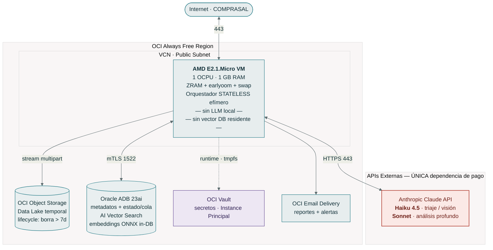
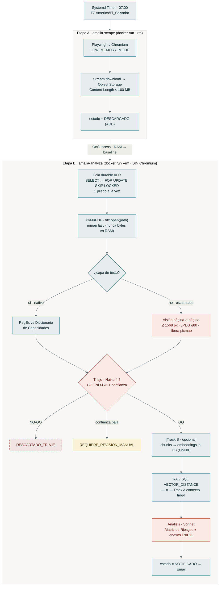

# Diagramas HLD / LLD · AMALIA v2 (fuente Mermaid)

> Reemplaza a `diagramas_hld_lld_amalia.png` (obsoleto: mostraba Ollama local + ChromaDB/Qdrant residentes, ambos eliminados en v2).
> Fuente de verdad editable. Ver `docs/arquitectura/vision-general.md` e `docs/arquitectura/modelo-de-datos.md`.

**Principios v2 codificados en los diagramas:**
- La VM de 1 GB es un **orquestador stateless**: sin LLM local, sin vector DB residente.
- **Única API externa de pago = Anthropic** (Haiku 4.5 triaje/visión · Sonnet análisis).
- **Un solo vector store**: Oracle ADB 23ai (embeddings ONNX *in-database*).
- **Dos etapas efímeras aisladas en memoria**: Chromium y PDF/LLM nunca coexisten.

---

## 1. HLD — Arquitectura de solución (topología)



---

## 2. LLD — Flujo de ejecución en dos etapas efímeras aisladas



> Franja roja = llamadas a Claude (única API de pago). Cada `docker run --rm` arranca en baseline: el pico de Chromium (Etapa A) y el de PDF+LLM (Etapa B) **nunca se suman**.

---

## 3. Máquina de estados del pliego (ciclo de vida · idempotente)

```mermaid
%%{init: {'theme':'base','themeVariables':{'fontFamily':'ui-monospace, monospace','lineColor':'#5C6B6E','primaryColor':'#E7EDEE','primaryBorderColor':'#12707D','primaryTextColor':'#123039','tertiaryColor':'#FCFCFB','tertiaryTextColor':'#123039','labelColor':'#123039'}}}%%
stateDiagram-v2
  classDef default fill:#E7EDEE,stroke:#12707D,color:#123039
  [*] --> DESCUBIERTO
  DESCUBIERTO --> DESCARGADO: descarga OK → Object Storage
  DESCARGADO --> DESCARTADO_TAMANO: > 100 MB
  DESCARGADO --> FORMATO_NATIVO: hay capa de texto
  DESCARGADO --> FORMATO_ESCANEADO: sin texto
  FORMATO_NATIVO --> DESCARTADO_REGEX: sin match RegEx
  FORMATO_NATIVO --> triaje: match
  FORMATO_ESCANEADO --> triaje: visión Haiku
  state triaje <<choice>>
  triaje --> DESCARTADO_TRIAJE: NO-GO
  triaje --> REQUIERE_REVISION_MANUAL: confianza baja
  triaje --> APROBADO: GO
  APROBADO --> VECTORIZADO: chunks + embeddings in-DB
  VECTORIZADO --> ANALIZADO: Sonnet · matriz de riesgos
  ANALIZADO --> NOTIFICADO: Email / Webhook
  NOTIFICADO --> [*]
  DESCARTADO_TAMANO --> [*]
  DESCARTADO_REGEX --> [*]
  DESCARTADO_TRIAJE --> [*]
  REQUIERE_REVISION_MANUAL --> [*]

  note right of NOTIFICADO
    Estados ERROR_* (DESCARGA/PARSEO/LLM/BD)
    reintentables hasta intentos < 5.
    La Etapa B reanuda cualquier estado
    no-terminal vía la cola SKIP LOCKED.
  end note
```

---

*Documento interno de Multicómputos El Salvador. Diagramas fuente en Mermaid — editar aquí, no regenerar PNG a mano.*
